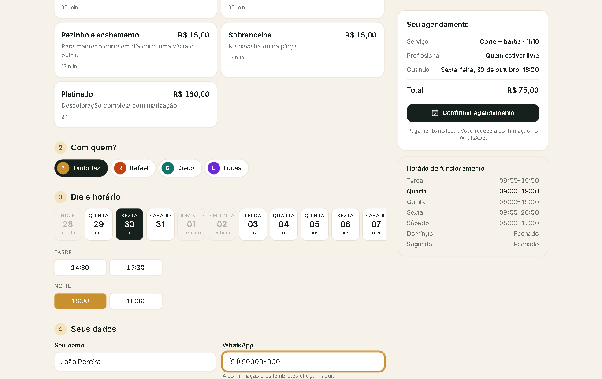
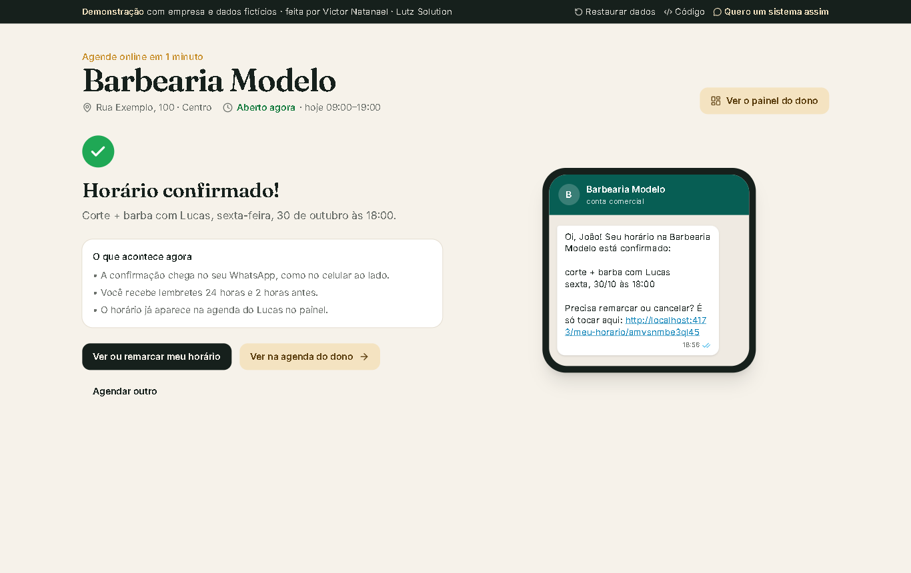
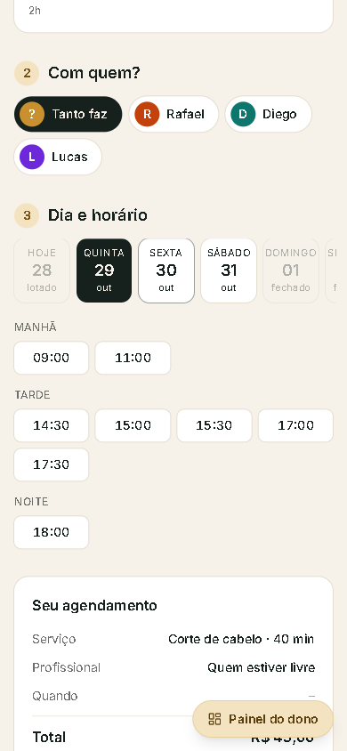
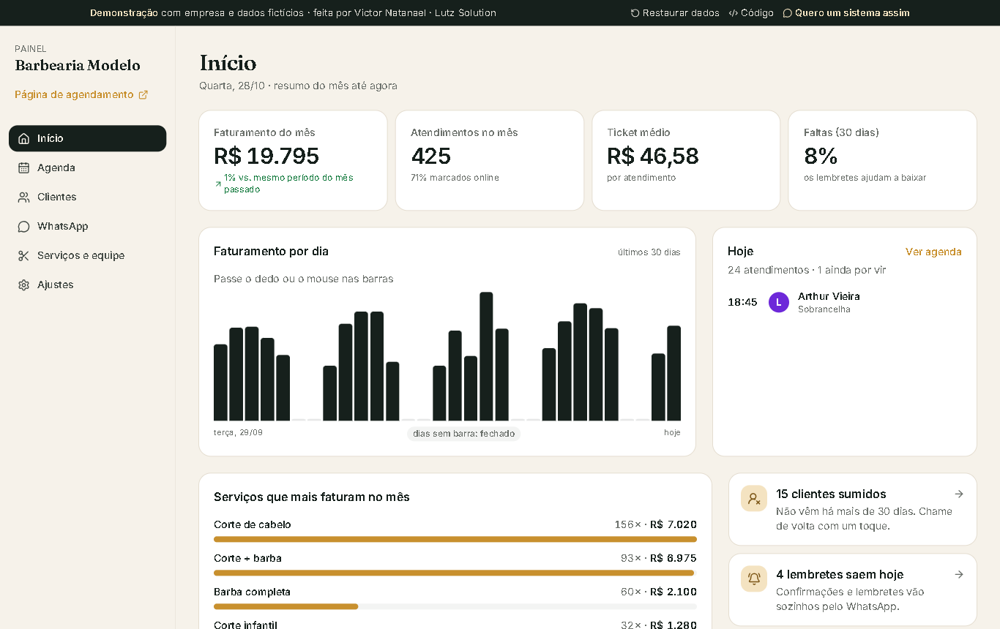
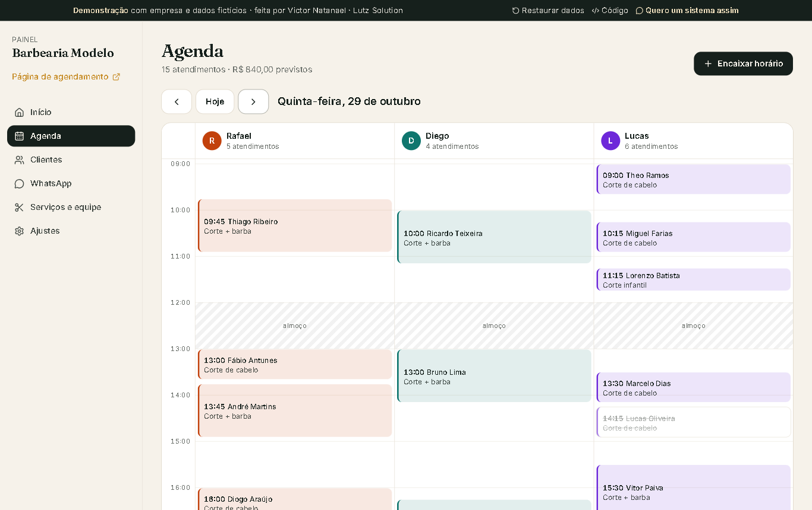
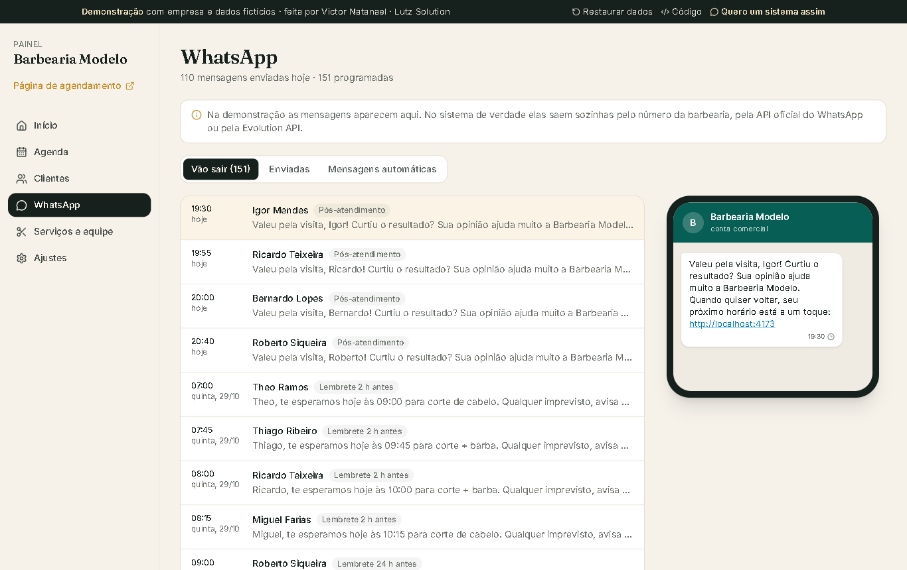

# Lutz Agenda

Agenda online com lembretes automáticos no WhatsApp. O cliente marca o horário sozinho pelo celular, e o dono acompanha agenda, clientes, faturamento e mensagens num painel.

**[Abrir a demonstração](https://lutz-agenda.vercel.app)** · funciona sem login, com uma barbearia e dados fictícios. Mexa à vontade: tudo fica só no seu navegador, e o botão "Restaurar dados" volta ao início.



## Para o cliente

- Escolhe o serviço, o profissional (ou "tanto faz") e um horário livre.
- Só aparecem horários em que o serviço cabe inteiro: dentro do expediente, fora do almoço, sem encostar em outro atendimento e respeitando a antecedência mínima.
- Recebe a confirmação no WhatsApp com um link para remarcar ou cancelar sem precisar ligar.

<table>
  <tr>
    <td></td>
    <td></td>
  </tr>
</table>

## Para o dono

- **Início:** faturamento do mês comparado com o mês passado, ticket médio, taxa de faltas, gráfico por dia e os serviços que mais faturam.
- **Agenda:** uma coluna por profissional, com almoço, folgas e a linha da hora atual. Marca atendido, faltou ou cancelado, e encaixa horário na hora.
- **Clientes:** histórico, total gasto e quem sumiu há mais de 30 dias, com um botão para chamar de volta pelo WhatsApp.
- **WhatsApp:** confirmação, lembrete 24 h antes, lembrete 2 h antes e pós-atendimento saem sozinhos. Os textos são editáveis, com variáveis como `{nome}` e `{hora}`.
- **Serviços, equipe e ajustes:** preços, durações, dias de cada profissional, horário de funcionamento e regras do agendamento online.





## Como é feito

- React 19, TypeScript, Vite, Tailwind CSS 4 e date-fns.
- As regras ficam separadas das telas, em `src/regras/`: cálculo de horários livres, quando cada mensagem sai e indicadores. São cobertas por testes (`npm run teste`).
- Na demonstração os dados moram no navegador (`src/dados/loja.ts`), para qualquer pessoa testar sem cadastro. Num cliente de verdade, essa camada vira um banco Supabase/Postgres e as mensagens saem pela API oficial do WhatsApp ou pela Evolution API, sem mudar as telas.

```bash
npm install
npm run dev      # abre em http://localhost:5173
npm run teste    # testes das regras
npm run build
```

## Quer um sistema assim para o seu negócio?

Feito por **Victor Natanael · Lutz Solution**. [WhatsApp (51) 99832-8628](https://wa.me/5551998328628) · [victorconceicao682@gmail.com](mailto:victorconceicao682@gmail.com) · [Outros projetos](https://github.com/VictorNlc)
